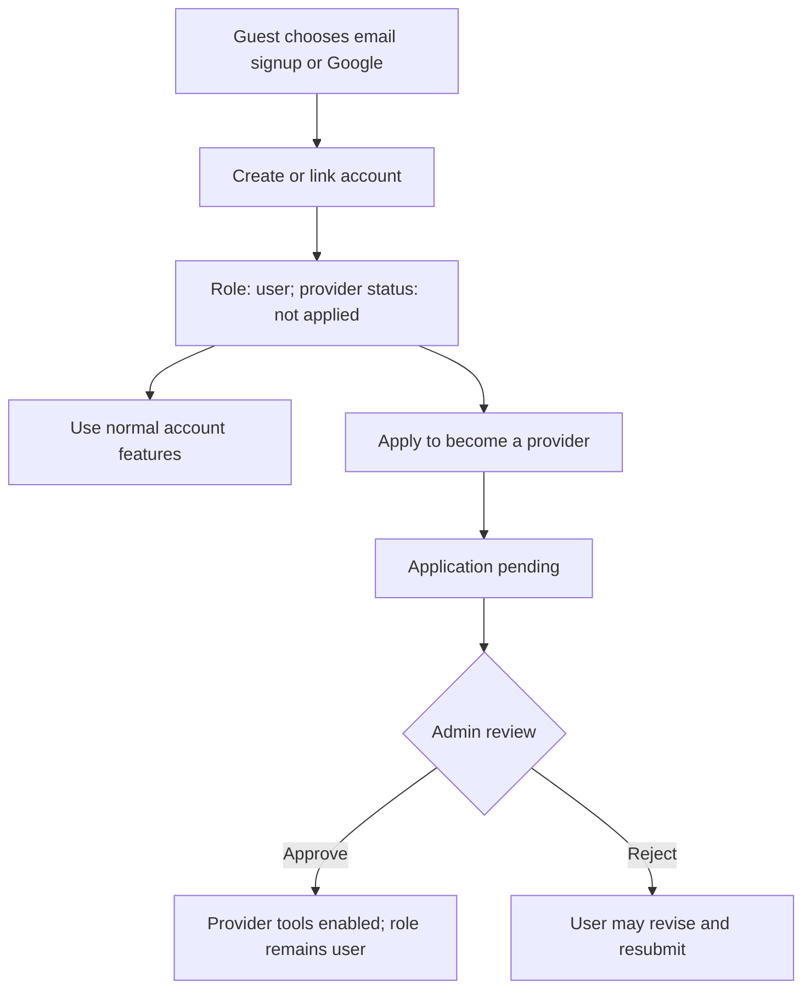
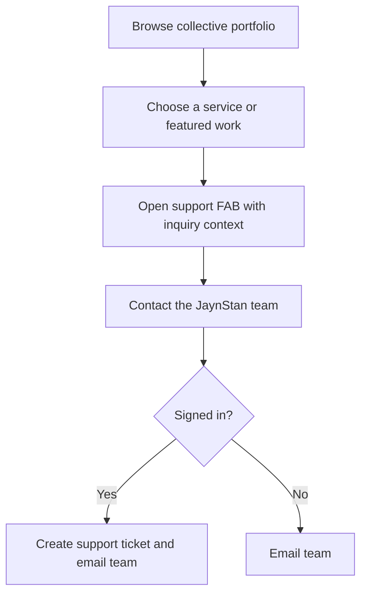
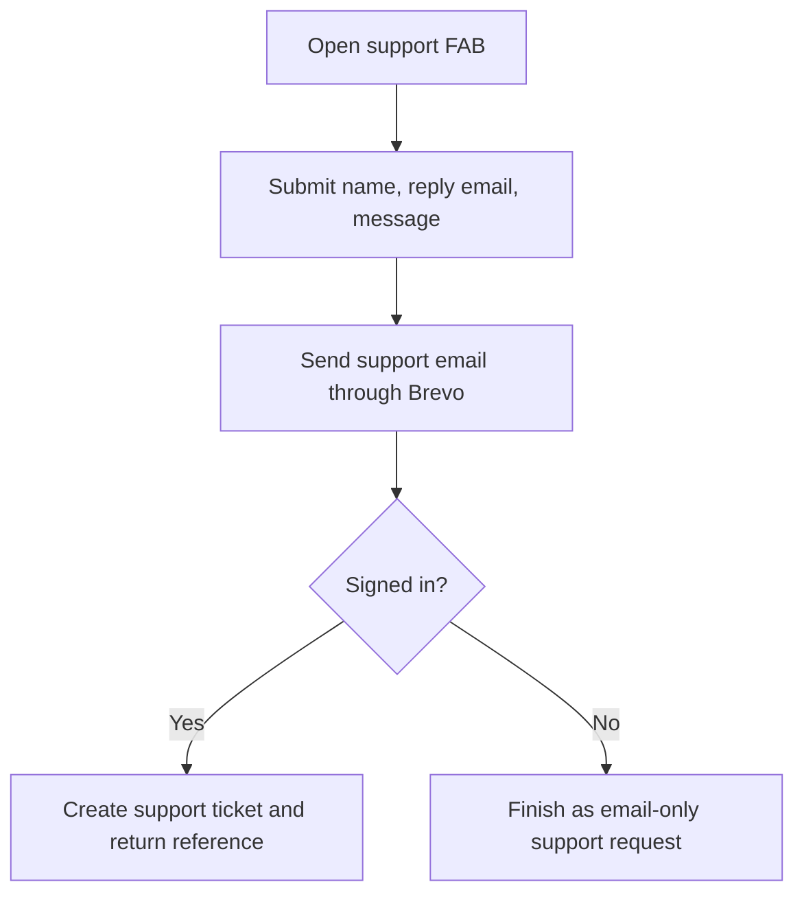

# JaynStan platform flows

This document records the agreed product flow for account access, provider onboarding, service listings, contact, messaging, and support. The three account roles are `user`, `admin`, and `superadmin`. Provider status is a separate approval state; an approved provider remains a `user`.

## Roles and access

| Actor | Capabilities |
| --- | --- |
| Guest | Browse the collective portfolio and contact JaynStan through support. Cannot create an account-scoped support ticket. |
| User | All guest access, account profile, support tickets, and provider application. Inquiries are coordinated by the JaynStan team. |
| Admin | Review provider applications, manage public service listings, and manage support tickets. |
| Superadmin | All admin capabilities plus elevated account and administrator management. |

Role checks belong on the API. Hiding a client control is not authorization. Provider approval must not grant admin privileges.

## Account signup and sign-in

1. A person creates a standard user account with name, email, and password, or continues with Google OAuth.
2. Local signups receive a one-time email verification link that expires after one hour. They must verify before password sign-in. Google OAuth accounts are verified by Google's identity response.
3. The server normalizes and uniquely checks the email, hashes local passwords, and creates the account with role `user`.
4. OAuth accounts are matched to an existing account by verified email before linking the Google subject. A Google profile picture is imported into JaynStan's Cloudinary folder; the application stores the Cloudinary URL rather than relying on Google's temporary image URL.
5. After verification, the person can use normal user features. Provider status starts as `not_applied`.
5. The initial superadmin is provisioned by a server seed using root environment credentials. Public signup and provider applications cannot assign elevated roles.

## Provider application and review

1. A signed-in user chooses **Apply to become a provider**.
2. The application collects the applicant name, phone number, and service category. The category list must match the public client categories: `software-development`, `graphic-design`, `artwork-painting`, and `architecture`.
3. The server records an application with status `pending` and associates it with the current user. The user cannot submit duplicate pending applications.
4. An admin or superadmin reviews the application and approves or rejects it. The reviewer and decision time are recorded; a rejection may include a reason.
5. Approval enables provider tools while the account role remains `user`. Rejected users can update and resubmit their application.

## Provider service listings

1. An approved provider creates a listing with a title, one of the approved categories, a description, and an image uploaded to Cloudinary.
2. A graphic-design listing may also include a PDF moodboard. The PDF is uploaded to Google Drive, and the listing stores its Drive file ID and viewer URL.
3. A public listing detail page displays the image and service details. When a viewer link is available, it opens the PDF in Google Drive.
4. Providers can update or remove their own listings. Admins can moderate any listing. The API verifies ownership and provider approval on every write.

Because guests must be able to view a listing's moodboard, the Drive file needs viewer access for the audience that can open the service page. The upload integration should set a view-only permission and must never expose Drive credentials to the client.

## Contacting JaynStan

JaynStan is presented as a collective portfolio. Guests and signed-in users contact the JaynStan team through the support FAB rather than choosing an individual creative. The team coordinates the right skills for the full brief. Signed-in requests create support tickets; guest requests are sent to the support inbox by email.

Authenticated in-app messaging can later power the team conversation workflow, with membership checks on persisted messages and WebSocket delivery. Public listings must not direct clients to an individual provider's personal contact methods unless the product direction changes.

## Support floating action button

1. The support FAB is available across the site to guests and signed-in users, with a separate back-to-top control after scrolling.
2. Both flows collect a message and a reply email; guests also provide a name.
3. `POST /api/support/contact` sends the request to `SUPPORT_EMAIL` (or the configured Brevo sender address) through Brevo.
4. For a signed-in user, the server also creates a support ticket associated with that account and returns the ticket reference. A guest request is emailed without creating an account-linked ticket.
5. Support replies and ticket status changes are handled through the authenticated ticket workflow.

## Initial API surface

The implementation can be delivered in vertical slices with these route groups:

- Implemented: `POST /api/auth/signup`, `POST /api/auth/verify-email`, `POST /api/auth/resend-verification`, `POST /api/auth/login`, `POST /api/auth/forgot-password`, `POST /api/auth/reset-password`, `GET /api/auth/google`, `GET /api/auth/google/callback`, `POST /api/auth/google/exchange`, and `GET /api/auth/me`.
- Implemented: `GET /api/featured-works` and admin-only create/list/feature/remove operations under `/api/admin/featured-works`.
- Implemented: `POST /api/support/contact`; authenticated messages create a support ticket and email support.
- Planned: `POST /api/auth/logout` (current access tokens are client-side session tokens and expire).
- `POST /api/provider-applications`, `GET /api/provider-applications/me`, and admin review/list endpoints.
- Public service list/detail endpoints, plus authenticated provider create/update/delete endpoints.
- Authenticated conversation creation/history endpoints and WebSocket events for message delivery.
- A support contact endpoint that emails all submissions and creates a ticket only for an authenticated account.

## Core records

- `users`: identity, password hash or Google subject, Cloudinary profile image URL, role, and contact details.
- `provider_applications`: applicant, selected category, status, review metadata, and optional rejection reason.
- `services`: provider, category, title, description, image URL, optional Drive file ID/view URL, visibility, and timestamps.
- `provider_contact_methods`: provider, method, destination, and enabled state.
- `conversations` and `messages`: participant membership, message author, body, and timestamps.
- `support_tickets` and `support_messages`: optional user association, ticket reference, status, and conversation history.
- `featured_works`: admin-curated homepage portfolio items, categories, image links, and optional project URLs.

Keep account roles, provider approval, listing visibility, and support-ticket status as separate fields. This prevents provider approval from accidentally granting administrative access.
